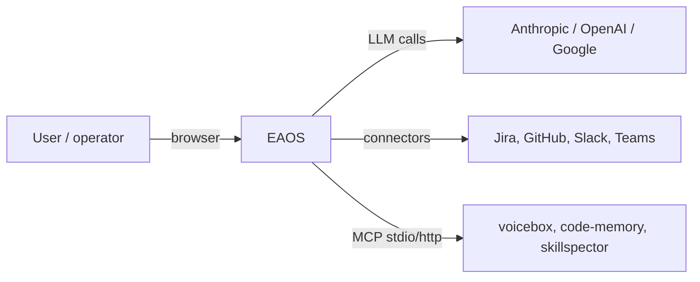
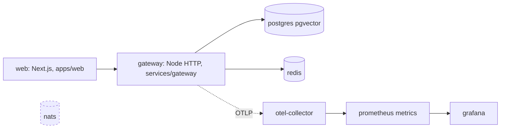
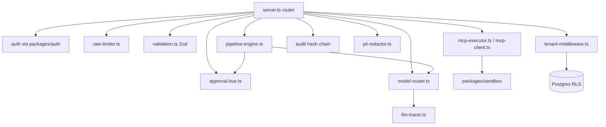
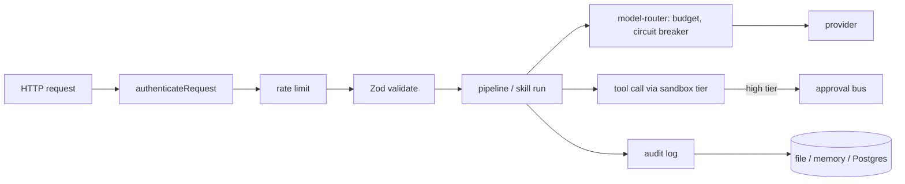
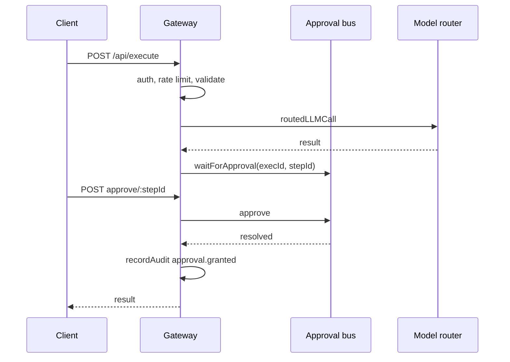
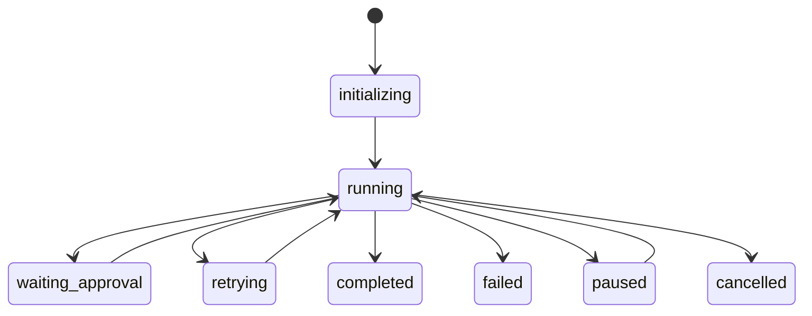
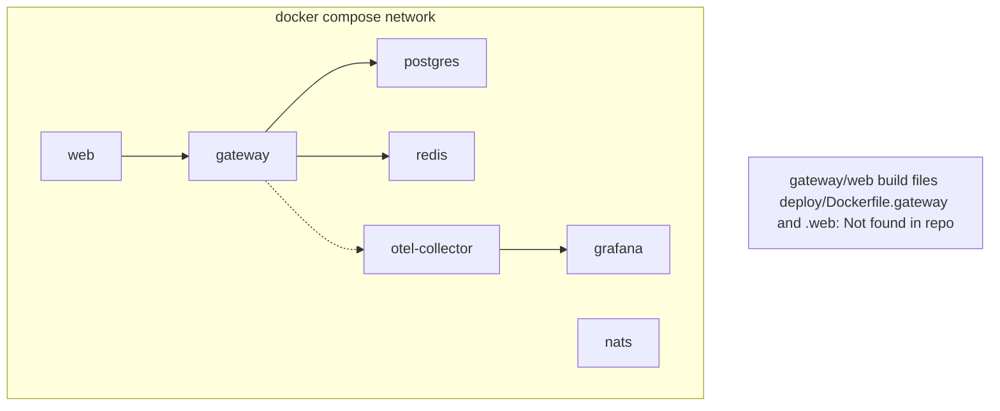
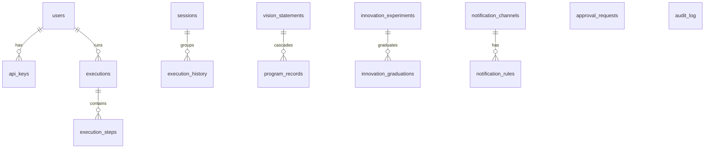

# 🧠 Enterprise Agent OS (EAOS)

> 🚀 **Envisioning how future enterprises will run — with AI agents doing the work humans do today.**
>
> EAOS models a company as an **organization of AI agents**: a C-suite that sets direction, five regiments that execute, and a governance layer that keeps every decision auditable — so work flows from **intent to outcome** without a human driving each step.

EAOS is a **control plane for enterprise work**. You describe the outcome in plain language; an organization of agents decomposes it, routes it to the right specialists, executes it through your real tools, and hands back a reviewed, traceable result. It doesn't replace your tools — it **orchestrates** them: agents think and decide, skills and tools execute, workflows give structure, and humans stay in control through approvals and audit.

**Why it matters:** today software waits for a human to operate it. EAOS flips that — describe a goal, not a sequence of clicks; get an organization of agents, not a single chatbot; keep your tools and your governance. It runs in a safe **simulation mode** out of the box, and goes live the moment you add an API key.

> 🧩 *Think: "Kubernetes for Enterprise Workflows"* — Agents = Pods · Skills = Containers · Workflows = Deployments · MCP = Service Mesh · UTCP = API Schema.


---

## ✨ Highlights

- 🤖 **53 autonomous agents** across 5 regiments (Titan · Olympian · Asgard · Explorer · Eden)
- 🏛️ **Military hierarchy** — General → Field Marshal → Colonel → Captain → Corporal
- 🧰 **60+ pre-built skills** spanning Engineering, Marketing, Product, HR, Talent, PMO
- 🔌 **MCP tool layer** with 8+ adapters (Jira, GitHub, Slack, Confluence, HubSpot, GA4, LinkedIn, Figma)
- 🔄 **A2A protocol** for agent-to-agent delegation, review, critique, escalation
- 📦 **UTCP packets** — universal task context standard for every execution
- 🧭 **5 flagship workflows** — PRD→Jira · Incident RCA · Campaign Launch · Hiring Pipeline · Launch Readiness
- 🎯 **Model router** — Haiku → Sonnet → Opus with cost metering & circuit breakers
- 🛡️ **Governance built-in** — RBAC, audit trail, compliance checks, cost attribution, budget controls
- 📊 **150+ API routes** — fully implemented backend with real persistence
- 🧩 **Skill Library** — adopted, file-defined EAOS skills (QA loop · security audit · PRD writer · technical spec · product discovery) runnable from the UI
- 🏛️ **Regiment Review** — collaborative Strategy → Design → Engineering → DevEx review chain where each stage sees the prior verdicts
- 🔌 **Real MCP client** — stdio + HTTP transports with graceful degradation (codebase-memory, voicebox)
- 🎬 **Guided onboarding + dark mode** — storytelling home, an "experience the magic" first-run flow, light/dark themes, and toast feedback
- 🔒 **Hardened security** — OIDC JWKS verification · mandatory JWT in prod · IDOR-scoped reads · CORS allowlist · safe expression eval · SkillSpector skill-scan gate

---

## 🧬 How It Works

```
You state a goal
  → Intent Engine selects the workflow
    → Agents collaborate (A2A) and run skills
      → Tools execute the work (MCP)
        → Outputs are aggregated and reviewed
          → Human approves → Memory + after-action report
```

Vision-level goals are **decomposed** by the C-suite and **cascaded** down through regiments to individual agents — the same loop scales from a single skill run to a cross-functional swarm.

---

## ⚡ Quick Start

```bash
# 📥 Clone and install
git clone https://github.com/Phani3108/EAOS.git
cd EAOS
pnpm install

# 🔐 Set up environment
cp deploy/.env.example .env
# Edit .env — add at minimum: ANTHROPIC_API_KEY

# ▶️ Run gateway + frontend
pnpm dev

# 🐳 Or use Docker
docker compose -f deploy/docker-compose.production.yml up -d
```

- 🌐 **Frontend** — http://localhost:3010
- 🛠️ **Gateway** — http://localhost:3000
- 📈 **Grafana** — http://localhost:3001

### ✅ Prerequisites

- 🟢 Node.js >= 20.0.0
- 📦 pnpm >= 9.0.0

---

## 🏛️ Architecture

```
┌─────────────────────────────────────────────────────────┐
│                    Frontend (Next.js 14)                 │
│  Sidebar │ Command Palette │ Main Content │ Right Panel  │
├──────────┴─────────────────┴──────────────┴─────────────┤
│                    Gateway API (Node.js)                 │
│  150+ API routes │ JWT Auth │ Event Bus │ WebSocket      │
├─────────────────────────────────────────────────────────┤
│              Agent Hierarchy (53 Agents)                 │
│  Titan │ Olympian │ Asgard │ Explorer │ Eden Regiments   │
├─────────────────────────────────────────────────────────┤
│  C-Suite Layer │ Vision/PMO │ Innovation │ Budget/Cost   │
├─────────────────────────────────────────────────────────┤
│  Persistence: File-backed │ PostgreSQL │ In-Memory       │
│  Event Bus │ Notification Dispatch │ Webhook Connector   │
├─────────────────────────────────────────────────────────┤
│  Connectors: Jira │ GitHub │ Slack │ Teams │ HubSpot     │
└─────────────────────────────────────────────────────────┘
```

### 🪖 Organizational Hierarchy

- 🏛️ **Board / Vision Layer**
  - 👑 **CEO** — Supreme Commander · Titan Regiment
    - 📣 **CMO** → Olympian Regiment (Marketing)
    - 🛠️ **CTO** → Asgard Regiment (Engineering)
    - 📐 **CPO** → Explorer Regiment (Product)
    - 🧑‍💼 **CHRO** → Eden Regiment (HR & Talent)
    - 💰 **CFO** → Budget Intelligence
    - 📋 **PMO** → Program Management Office

---

## 🧱 Tech Stack

| Layer | Technology |
|---|---|
| 🎨 **Frontend** | Next.js 14 · React 18 · TypeScript · Tailwind · Zustand · Framer Motion |
| 🛣️ **Gateway API** | Node.js HTTP server · TypeScript |
| 🗄️ **State** | Zustand |
| 🔄 **Data Fetching** | TanStack React Query |
| 📦 **Monorepo** | pnpm workspaces · Turborepo |
| 📐 **Schemas** | JSON Schema (skills · tools · prompts · workflows · workers · policies) |
| 🐘 **Database** | PostgreSQL (Prisma for Prompt Library) |
| 🤖 **Agent Runtimes** | LangGraph (default) · AutoGen · CrewAI · Custom |
| 🔌 **Connectors** | Jira · GitHub · Slack · Confluence · Teams |

---

## 📂 Project Structure

```
EAOS/
├── 🎨 apps/web/                # Next.js 14 frontend (App Router · Tailwind · Framer Motion)
├── 🛣️ services/
│   ├── gateway/                # API gateway (Node.js HTTP, 150+ routes) — the runtime core
│   ├── cognitive-engine/       # Multi-step LLM reasoning pipeline
│   └── memory/                 # Memory service
├── 📦 packages/                # 28 packages (schemas · auth · workflow-engine · memory-pipeline · router · policy · db · sandbox…)
├── 🧩 skills/                  # File-defined EAOS skills by persona (design · engineering · hr · product · program · marketing · leadership · learning)
├── 🗃️ skills-unported/         # Quarantined skills pending EAOS-native rewrite
├── 🔌 connectors/              # GitHub · Jira · Slack · Teams
├── 👷 workers/                 # developer-knowledge · incident-intelligence · engineering · marketing · leadership · transcript-actions
├── 🤖 agents/marketing/        # Marketing Agent Graph (SOMAN)
├── 🔄 workflows/               # Flagship cross-functional workflow DAGs
├── 🧠 third_party/             # Adopted-OSS notices + licenses (deer-flow · hermes · gstack · mattpocock)
├── 📚 prompt-library/          # Prompt Library (Prisma-based)
├── 🔌 mcp.servers.json         # MCP server registry (stdio + HTTP)
└── 📸 docs/screenshots/        # App screenshots
```

---

## 🛣️ API Endpoints (150+)

| Group | Routes | Description |
|---|---|---|
| 🔐 **Auth** | `POST /api/auth/token` · `GET /api/auth/me` | JWT issuance & user info |
| ▶️ **Execution** | `POST /api/execute` · `GET /api/executions[/:id]` | Unified skill execution |
| 👔 **C-Suite** | `GET /api/csuite[/:id[/chain]]` | Agent hierarchy & command chain |
| 🎯 **Vision/PMO** | `POST /api/vision[/:id/decompose,cascade]` | Vision decomposition & cascading |
| 🧪 **Innovation** | `/api/innovation/{experiments,hackathons,graduations}/*` | Innovation labs CRUD + state |
| 💰 **Budget** | `/api/budget/{agents,spend,alerts,dashboard}/*` | Cost tracking & CFO dashboard |
| 📈 **Improvement** | `/api/improvement/{reviews,plans,feedback,exemplars}/*` | Reviews · plans · feedback |
| 🔔 **Notifications** | `/api/notifications/{channels,rules,dispatch}/*` | Multi-channel dispatch |
| 🔗 **Webhooks** | `/api/webhooks/{endpoints,subscriptions,receive}/*` | HMAC-SHA256 signed |
| 🧩 **Skills** | `/api/skills/unified` · `/api/marketplace/skills/*` | Marketplace with voting |
| 🪟 **Personas** | `/api/{engineering,product,hr,marketing}/*` | Persona-gated execution |
| 🤖 **Agents** | `/api/agents/{registry,kpis,memory}` | Registry · KPIs · memory |
| ⏰ **Scheduler** | `/api/scheduler/{jobs,events}/*` | Cron / interval / event-driven |
| 💬 **Blog/Forum** | `/api/{blog/posts,forum/threads}/*` | Content with voting |
| 🧠 **Cognitive** | `/api/cognitive/{process,decompose,reason}` | Multi-step LLM pipeline |
| 🔍 **Observability** | `/api/{governance/audit,events,health}` | Audit · events · health |
| 🧩 **Skill Library** | `/api/skills/fs[/execute]` · `/api/skills/scan` | File-defined skills + scan gate |
| 🏛️ **Review** | `/api/review/{run,chain}` | Collaborative Regiment Review chain |
| 🔌 **MCP** | `/api/mcp/{servers,tools,execute,stats}` | Real MCP client (stdio + HTTP) |
| 🐝 **Swarms** | `/api/swarms/{launch,templates,stats}` | A2A swarm orchestration |

---

## 🌐 Marketing Agent Graph (SOMAN)

The **Self-Optimizing Marketing Agent Network** — a collaborative agent system reasoning through shared state:

```
                     🧭 Marketing Orchestrator
                              │
         ┌────────────────────┼────────────────────┐
         │                    │                    │
   🔍 Research          🎯 Strategy          📊 Analytics
         │                    │                    │
         ├──────────┐         │         ┌──────────┤
         │          │         │         │          │
    🔎 SEO    🥊 Competitor   │   ✍️ Copy   📣 Campaign
                              │      │
                              │  🎨 Design
                              │      │
                       📧 Email · 🛬 Landing Page
                                │
                       🔁 Optimization Agent ◀── Feedback Loop
```

🔁 **Optimization loop:** Campaign → Performance Signals → Analytics → Optimization → Strategy Adjust → Creative Regen → New Campaign

---

## 📐 Schemas

All definitions are validated against JSON schemas in `packages/schemas/`:

- 🧩 `skill.schema.json` — Skill definitions
- 🔌 `tool.schema.json` — Tool connectors
- 📚 `prompt.schema.json` — Prompt library entries
- 🔄 `workflow.schema.json` — Workflow definitions
- 👷 `worker.schema.json` — Worker configurations
- 📡 `event.schema.json` — Event types
- 🛡️ `policy.schema.json` — Policy rules
- 🌐 `capability-graph.schema.json` — Tool capability graph

---

## 🧠 Adopted Open Source

EAOS harvests and adapts best-in-class open-source agent tooling into EAOS-native form (full notices in `third_party/NOTICE`):

| Source | Adopted as |
|---|---|
| **bytedance/deer-flow** | Orchestrator prompt (live in the swarm path) + AgentMemory schema |
| **Hermes Agent** | Best-practice agent use cases |
| **gstack · mattpocock skills** | Curated, EAOS-renamed entries in the Skill Library |

> 🧩 Adopted artifacts use **EAOS nomenclature**, not source-repo names, so the platform speaks one consistent language.

---

## Production Readiness

Review date: 2026-10-26. Audited at commit `ae84b84` on `main`, using `.claude/skills/project-completion-gate/SKILL.md`. Evidence is from the repo only. Anything not in the repo is marked "Not found in repo".

**Coverage.** This is a sample, not a full read.
- Read: `README.md`, `TASKS.md`, `mcp.servers.json`, `turbo.json`, `pnpm-workspace.yaml`, `.claude/settings.json`, `.github/workflows/ci.yml`, `deploy/*`, `tests/` (headers), `docs/architecture/{production-readiness,brutal-audit}.md`.
- Sampled: `services/gateway/src` (`server.ts`, `model-router.ts`, `rate-limiter.ts`, `validation.ts`, `approval-bus.ts`, `pii-redactor.ts`, `llm-tracer.ts`, `gdpr-api.ts`, `health.ts`, `tenant-middleware.ts`, `mcp-executor.ts`, `pipeline-engine.ts`, `agent-evals.ts`), `packages/{auth,approval,db,sandbox,observability,evaluation}`, `packages/db/migrations`.
- Not sampled: `agents/marketing`, `workers/*` (only `engineering/worker.yaml` listed), `connectors/*`, `skills/*`, `skills-unported`, `workflows/*`, `prompt-library`, `apps/web` source, `third_party`, most of `packages/*`, and the 20 files under `docs/architecture` beyond the two above. Findings do not cover these.

### Scorecard

| Dimension | Status |
|---|---|
| 1. Guardrails | Partial |
| 2. Evals | Partial |
| 3. Observability | Partial |
| 4. Security | Partial |
| 5. Human in the loop | Partial |
| 6. Architecture diagrams | Partial (this section adds them; older docs not checked against code) |

### 1. Guardrails: Partial
- Present
  - Zod request validation: `services/gateway/src/validation.ts`, used in `server.ts` (`/api/execute`, UTCP packets).
  - Body size cap 5 MB: `server.ts` (`MAX_BODY_BYTES`).
  - Per-role and per-persona rate limits: `services/gateway/src/rate-limiter.ts`.
  - Hourly cost cap, provider circuit breaker, `maxTokens` by complexity: `services/gateway/src/model-router.ts`.
  - Tool risk tiers; high tiers return "requires human approval": `packages/sandbox/src/sandbox.ts`, `services/gateway/src/mcp-executor.ts`.
  - Skill scan gate for prompt-injection in skills: `services/gateway/src/skill-scan.ts` (needs `SKILLSPECTOR_CMD`, see `mcp.servers.json`; otherwise returns `engine: 'none (not configured)'`).
  - PII redaction: `services/gateway/src/pii-redactor.ts`, exposed at `POST /api/governance/pii/scan` and imported in `persona-api.ts`.
- Missing or unverified
  - Prompt-injection handling for runtime content (tool results, fetched documents): Not found in repo.
  - Output schema or policy check on every LLM response: not verified. `packages/output-schemas` and `packages/policy` exist but were not traced into the gateway path.
  - Per-run loop and retry ceiling for agents: not verified.
- If it stays this way
  - Untrusted text from connectors can steer an agent into a tool call.
  - PII can reach outputs if redaction is only called on demand.
  - Without the scan tool configured, skills are not screened.
- Action: wire `redactPII` and an output-schema check into the single LLM call path in `model-router.ts`, and make `SKILLSPECTOR_CMD` required when `NODE_ENV=production`.

### 2. Evals: Partial
- Present
  - Eval cases with rubric in the repo: `packages/evaluation/tests/evaluation-tests.yaml` (method `llm-judge`).
  - Runtime agent health, drift and cost alerts: `services/gateway/src/agent-evals.ts`.
  - API and integration tests: `tests/api.test.ts`, `tests/integration.test.ts`, `tests/load-test.ts`.
- Missing
  - No CI step runs the eval YAML or blocks on a threshold: `.github/workflows/ci.yml`.
  - `pnpm test` runs `vitest run --passWithNoTests` in packages (e.g. `packages/evaluation/package.json`). Only four test files exist outside `third_party` and all are in `tests/`; they need a running gateway and are not run by `turbo run test` (`package.json`: `test:api`, `test:integration`).
  - Judge calibration: Not found in repo.
  - `TASKS.md` lists "Task quality scoring (LLM-as-judge)" and "Regression detection" as unchecked.
  - `agent-evals.ts` header says seed data is random at boot; scores can be synthetic until real executions exist.
- If it stays this way
  - A change can ship that lowers output quality and nothing fails.
  - CI shows green while running almost no tests.
- Action: add a CI job that runs `evaluation-tests.yaml` with a pass threshold, and add `tests/` to CI against the gateway started in the smoke step.

### 3. Observability: Partial
- Present
  - OpenTelemetry package: `packages/observability/src/{otel,tracer}.ts`; LLM spans and token/cost counters: `services/gateway/src/llm-tracer.ts`.
  - Health and Prometheus-style metrics: `services/gateway/src/health.ts`.
  - Collector, Prometheus and Grafana in `deploy/otel-config.yaml`, `deploy/prometheus.yaml`, `deploy/docker-compose.production.yml`.
  - Hash-chained audit log with user, action, target: `server.ts` (`recordAudit`), `packages/db/migrations/006_audit_persistence.sql`; verify route `/api/governance/audit/verify`.
- Gaps
  - Traces are exported to `debug` only: `deploy/otel-config.yaml`. No trace backend is configured.
  - `deploy/prometheus.yaml` scrapes `gateway:3000` with `metrics_path: /api/health`; `health.ts` mentions a `/metrics` endpoint. Which path is correct was not verified.
  - Alert rules and Grafana dashboards: Not found in repo (`TASKS.md` lists both unchecked).
  - Structured logs with run IDs and trace propagation across worker chains: not verified; `TASKS.md` lists propagation unchecked.
- If it stays this way
  - Failures and cost spikes are found by users, not by alerts.
  - A run cannot be followed across services.
- Action: point the traces pipeline at a real backend, fix the scrape path, and add alert rules for error rate and hourly spend.

### 4. Security: Partial
- Present
  - Production refuses to start without `JWT_SECRET`/`AUTH_SECRET`; dev API keys and anonymous fallback are off in production: `packages/auth/src/middleware.ts`.
  - CORS allowlist via `CORS_ALLOWED_ORIGINS`: `server.ts`.
  - Tenant isolation through row-level security: `services/gateway/src/tenant-middleware.ts`, `packages/db/migrations/005_multi_tenancy.sql`.
  - GDPR erase: `services/gateway/src/gdpr-api.ts`.
  - `.env` ignored, `.env.example` committed: `.gitignore`, `.env.example`.
  - Container runs as non-root user `eaos`: `deploy/Dockerfile`.
  - Secrets package: `packages/secrets/src/vault.ts`.
- Gaps
  - Default secrets in the production compose file: `JWT_SECRET` falls back to `agentos-production-secret-change-me`, `POSTGRES_PASSWORD` to `eaos-dev-password`, Grafana admin password to `admin` (`deploy/docker-compose.production.yml`). Because the JWT fallback is non-empty, the startup check in `middleware.ts` would pass with the public default.
  - CORS is `*` when `CORS_ALLOWED_ORIGINS` is unset: `server.ts`.
  - The production compose file builds `deploy/Dockerfile.gateway` and `deploy/Dockerfile.web`; only `deploy/Dockerfile` exists. The documented Docker path cannot build as written.
  - `README.md` Quick Start says `cp deploy/.env.example .env`; the file is `.env.example` at the repo root.
  - `SECURITY.md`: Not found in repo. Dependency and container scanning: Not found in repo (`.github` has only `workflows/ci.yml`).
  - Security response headers: Not found in repo (searched `server.ts`).
  - Upload and URL-fetch limits: not verified.
  - `TASKS.md` lists secrets management, mTLS and prompt sanitisation as unchecked.
  - Licence text conflicts: `README.md` says MIT; `package.json` says `UNLICENSED`.
- If it stays this way
  - A deploy with unset variables runs with publicly known credentials.
  - Vulnerable dependencies go unnoticed.
  - Researchers have no reporting path.
- Action: remove the compose fallbacks (use `${VAR:?}`), set a CORS default of deny, add the two missing Dockerfiles or point to `deploy/Dockerfile`, add `SECURITY.md` and a dependency scan job.

### 5. Human in the loop: Partial
- Present
  - Approval bus with pending list, approve/reject, 24 h SLA summary: `services/gateway/src/approval-bus.ts`; routes `/api/approvals/*` in `server.ts`; audit entries `approval.granted` / `approval.rejected`.
  - Pipeline state `waiting_approval`, plus `paused` and `cancelled`: `services/gateway/src/pipeline-engine.ts`.
  - Side-effecting tool calls blocked pending approval by risk tier: `mcp-executor.ts`, `packages/sandbox/src/sandbox.ts`.
  - Approval tables: `packages/db/migrations/001_initial.sql` (`approval_requests`).
  - Reviewer decisions are recorded in the audit log (see above).
- Gaps
  - `TASKS.md` shows "Human-in-the-loop approval gates in workflows", routing, timeout/escalation and notifications unchecked. The code has an approval bus, so `TASKS.md` and the code disagree. The owner should decide which is current.
  - `packages/approval/src/engine.ts` (policy-based `ApprovalEngine`) was not traced to the gateway; the gateway imports `approval-bus.ts`. Two approval implementations exist.
  - Global kill switch: Not found in repo.
  - Confidence-based escalation: Not found in repo.
- If it stays this way
  - Approvals can sit pending with no escalation.
  - There is no single stop control during an incident.
- Action: pick one approval implementation, add timeout escalation, and add a kill switch route that sets all running pipelines to `paused`.

### 6. Architecture diagrams: Partial
- Existing: 20 Mermaid-bearing files in `docs/architecture/`. They were not checked against code; `docs/architecture/brutal-audit.md` and `production-readiness.md` describe a state (no auth, no persistence) that differs from the code now present. Treat them as stale until reviewed.
- Below: diagrams derived from the sampled code. Elements not seen in code are not drawn.
- Not drawn: swimlane and waterfall (not code-derived artefacts, so the gate's "from code only" rule excludes them); NATS flows (NATS is in `deploy/docker-compose.production.yml` but no gateway code using it was found in the sample; `docs/architecture/brutal-audit.md` says the same).

C4 L1, context


C4 L2, containers (from `deploy/docker-compose.production.yml`, `vercel.json`)

- `nats` is deployed in compose; no client code found in the sample (dashed).

C4 L3, gateway components (files in `services/gateway/src`)


Data flow


Sequence, execution with approval (`server.ts` approval routes, `approval-bus.ts`)


State machine (`pipeline-engine.ts`: `PipelineStatus`)

- Exact transitions were not read; edges shown are the ones implied by statuses seen at `pipeline-engine.ts` lines near `waiting_approval` and `running`. Transitions to `paused`/`cancelled` are unverified.

Deployment (`deploy/docker-compose.production.yml`)


ER (tables and foreign keys from `packages/db/migrations/*.sql`; sampled tables only)

- `users`→`api_keys` is drawn from table order in `003_unified_execution.sql`; its foreign key was not confirmed. `vision_statements`→`program_records` is from `REFERENCES vision_statements` at `004_missing_tables.sql:119`; the child table at that line was not confirmed to be `program_records`. Treat both as unverified.

### Open items register

| # | Item | Owner | Date |
|---|---|---|---|
| 1 | Remove default JWT, Postgres and Grafana secrets from the production compose file | Phani Marupaka | 2026-10-26 |
| 2 | Add or repoint `deploy/Dockerfile.gateway` and `deploy/Dockerfile.web` | Phani Marupaka | 2026-10-26 |
| 3 | Decide the default CORS policy when `CORS_ALLOWED_ORIGINS` is unset | Phani Marupaka | 2026-10-26 |
| 4 | Add eval run with pass threshold to CI; add `tests/` to CI | Phani Marupaka | 2026-10-26 |
| 5 | Remove `continue-on-error` from typecheck, lint and smoke test, or record why it stays | Phani Marupaka | 2026-10-26 |
| 6 | Choose one approval implementation (`approval-bus.ts` or `packages/approval`); add timeout escalation | Phani Marupaka | 2026-10-26 |
| 7 | Add a kill switch route | Phani Marupaka | 2026-10-26 |
| 8 | Add prompt-injection handling for tool results and fetched content | Phani Marupaka | 2026-10-26 |
| 9 | Add `SECURITY.md` and a dependency/container scan job | Phani Marupaka | 2026-10-26 |
| 10 | Point OTel traces at a backend; confirm Prometheus scrape path; add alert rules | Phani Marupaka | 2026-10-26 |
| 11 | Fix README Quick Start env path (`deploy/.env.example` does not exist) and licence mismatch (MIT vs UNLICENSED) | Phani Marupaka | 2026-10-26 |
| 12 | Review `docs/architecture/*` against code; mark stale files | Phani Marupaka | 2026-10-26 |
| 13 | Review the groups not sampled (workers, connectors, agents, skills, apps/web) | Phani Marupaka | 2026-10-26 |

### Verdict: Not ready

Per the gate, Ready needs no Missing on Guardrails, Security or Human in the loop, and evals gating the release. Here none of the three is Missing, but evals do not gate release and several Partial items carry real risk. Blockers, in order:
1. Default production secrets in `deploy/docker-compose.production.yml` (item 1).
2. Production compose cannot build as written (item 2).
3. No eval or test gate in CI; `continue-on-error` on typecheck, lint and smoke test (items 4, 5).
4. No kill switch, and approval escalation is open (items 6, 7).
5. No prompt-injection handling for runtime content (item 8).

---

## 📜 License

MIT

---

## 👤 Author

**Created & developed by [Phani Marupaka](https://linkedin.com/in/phani-marupaka)**

© 2026 Phani Marupaka. All rights reserved.

> ⚖️ Unauthorized reproduction, distribution, or modification of this software, in whole or in part, is strictly prohibited under applicable trademark and copyright laws including but not limited to the Digital Millennium Copyright Act (DMCA), the Lanham Act (15 U.S.C. § 1051 et seq.), and equivalent international intellectual property statutes. This software contains embedded provenance markers and attribution watermarks protected under 17 U.S.C. § 1202. Removal or alteration of such markers constitutes a violation of federal law.

---

🛠️ Built with **Next.js · TypeScript · Tailwind CSS** — and a lot of AI agents. 🤖✨
