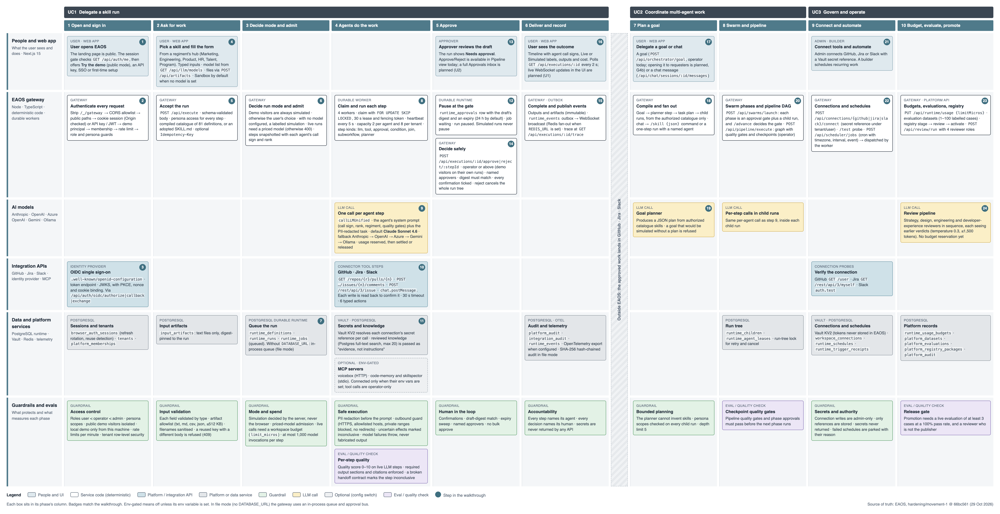

# 🧠 Enterprise Agent OS (EAOS)

> 🚀 **Envisioning how future enterprises will run — with AI agents doing the work humans do today.**
>
> EAOS models a company as an **organization of AI agents**: a C-suite that sets direction, five regiments that execute, and a governance layer that keeps every decision auditable — so work flows from **intent to outcome** without a human driving each step.

EAOS is a **control plane for enterprise work**. You describe the outcome in plain language; an organization of agents decomposes it, routes it to the right specialists, executes it through your real tools, and hands back a reviewed, traceable result. It doesn't replace your tools — it **orchestrates** them: agents think and decide, skills and tools execute, workflows give structure, and humans stay in control through approvals and audit.

**Why it matters:** today software waits for a human to operate it. EAOS flips that — describe a goal, not a sequence of clicks; get an organization of agents, not a single chatbot; keep your tools and your governance. It runs in a safe **simulation mode** out of the box, and goes live the moment you add an API key.

> 🧩 *Think: "Kubernetes for Enterprise Workflows"* — Agents = Pods · Skills = Containers · Workflows = Deployments · MCP = Service Mesh · UTCP = API Schema.


---

## 🛡️ Guardrails and evals

### Guardrails

| Guardrail | What it prevents | Where it is enforced | Default |
|---|---|---|---|
| Roles and persona scopes | Users acting outside their role or function | `packages/auth/src/middleware.ts`, `server.ts` route guards, every step's persona | On |
| Demo isolation | Demo visitors seeing others' work or spending budget | `run-mode.ts`, `server.ts` `/api/auth/demo`, artifact quota (20 files / 2 MB, 24 h) | Demo off unless `EAOS_DEMO_MODE` set; local demo only from this machine |
| Server-decided run mode | Hidden live runs; failed keyless runs | `run-mode.ts` in `preparePersonaExecution` (every run) | On |
| Priced-model admission | Unbudgetable model calls | `admitModel` in `llm-provider.ts` | On for live runs |
| Budget reservations | Overspend | `reserveUsage` (`limit_micros`), released when not billed | Live calls refused until a budget exists |
| Human approval gates | Unapproved external actions; approving a changed draft | `runtime_approvals`: digest, expiry, confirmations, named approvers | Per skill step |
| PII redaction | Personal data reaching the model | `pii-redactor.ts`, applied to the step task prompt | On (agent steps; review and chat prompts not yet) |
| Prompt-injection hardening | Knowledge or task text acting as instructions | Knowledge labelled "evidence, not instructions"; planner limited to the catalogue | Partial; no classifier |
| Outbound guard (SSRF) | Calls to internal networks or unexpected hosts | `outbound-http.ts`: HTTPS, host allowlist, DNS pinned, private ranges blocked, no redirects | On for connectors and Vault |
| Policy check | Disallowed tool calls | `checkPolicy` in `mcp-executor.ts` (deny-first) | File-mode tool path |
| Skill security scan | Unsafe adopted skills | SkillSpector via MCP (risk ≥ 50 or high finding fails) | Only when configured; fails open by default |
| Origin / CSRF checks | Cross-site requests riding a session | Cookie writes, demo, refresh, OIDC exchange | On |
| Rate limits | Abuse and floods | `rate-limiter.ts`: unauthenticated 10, sign-in 60, user 120, operator 300, admin 500 per minute | On |
| Tenant isolation | Cross-tenant reads and writes | Row-level security on every runtime table; production refuses an owner/superuser DB role | On |
| Idempotency | Duplicate runs from retries | `request_key` + body hash; mismatch → 409 | When the client sends a key |
| Artifact limits | Oversized or unsafe input files | Allowlist, ≤512 KB, sanitised names, immutable after commit | On |
| Secrets never returned | Credential leaks | Secret references only; HMAC-hashed API keys shown once; redacted configs | On |
| Honest failure | Fabricated success | LLM wrapper throws; uncertain effects become inconclusive | On |
| Audit trail | Unattributed actions | `platform_audit`, `integration_audit`, `runtime_events`; hash chain in file mode | On |

### Evals and quality gates

| Eval | What it measures | When it runs | Threshold | Status |
|---|---|---|---|---|
| Per-step quality score | Output quality heuristic (0–10) | Every live LLM step; averaged per run | Shown on the step | Live |
| Output contract | Required sections, citations, handoff fields | Every step | Missing → retry once, then inconclusive | Live |
| Evaluation datasets | Labelled pass/fail per case, with reasons | Recorded by operators (`/api/evaluations`) | 1–100 cases per dataset | Live |
| Registry release gate | Readiness to activate a skill package | On review | ≥3 live cases, 100% pass, reviewer ≠ publisher | Live |
| Workflow certification | Execution readiness per definition | `GET /api/certification` | Vendor sandbox: not yet certified | Partial |
| Catalogue certification (M5) | All 81 definitions complete simulated with outputs | CI (M2 runner) | 100% | Live in CI |
| Review pipeline | Multi-role review verdicts | On request | Approve / changes requested | Live; results not stored |
| Agent KPIs, after-action reports | Agent performance over time | After runs | — | File mode only; on PostgreSQL planned (G13) |
| Test suites | Correctness: 427 Vitest unit and contract tests, Postgres acceptance M0 (2 suites) and M2 (20 sections) (M3–M7 contracts), browser sign-in | Every pull request | All must pass | Live; blocking |
| CI gates | Audit (high), typecheck, lint, compose config, build, tests, Postgres acceptance, browser auth, gateway smoke (ready ≤60 s, clean SIGTERM) | Every push and pull request | All blocking | Live |

---

## 🗺️ End-to-end workflow

How a request becomes an agent run, an approved action and an audited outcome. The diagram shows every LLM call, platform API call, integration, data store, guardrail and eval the flow depends on.



<sub>Source of truth: EAOS, hardening/movement-1 @ 66bc561 (29 Oct 2026) · Full readout with every table: [docs/workflow/readout.html](docs/workflow/readout.html) (open locally or download).</sub>

| | |
|---|---|
| **Scope** | UC1 Delegate a skill run · UC2 Coordinate multi-agent work · UC3 Govern and operate |
| **Source of truth** | EAOS repository, branch `hardening/movement-1`, commit `66bc561`: source code, migrations 007–026, `packages/config` env spec, `.env.example`, compose files, CI workflow |
| **Planned items** | From `docs/roadmap.md` (experience slices U1–U5, backend gaps G1–G16). Labelled as planned |
| **Date** | 29 October 2026 |

### The flow, step by step

_Numbers match the badges in the diagram._

**UC1 · Open and sign in**

1. The user opens EAOS. The landing page is public. The session gate calls `GET /api/auth/me`. Without a session it offers **Try the demo** (when `EAOS_DEMO_MODE=public`), sign-in with an API key, organisation SSO, or first-time administrator setup (`POST /api/setup` with `EAOS_SETUP_TOKEN`).
2. Every request passes the gateway pipeline in order: strip the `/_/gateway` prefix → CORS allowlist → public-path check → cookie session (Origin checked on writes) or API key / JWT → demo principal → tenant membership (suspended → 403) → per-client rate limit → role and persona guards.
3. With SSO, the gateway runs OIDC with PKCE, nonce and cookie binding against the identity provider's discovery document, token endpoint and JWKS, then exchanges a one-time login code for a browser session.

**UC1 · Ask for work**

4. The user opens a regiment's hub (Marketing, Engineering, Product, HR, Talent or Program), picks a skill and fills a typed form. The model list comes from `GET /api/llm/models` (priced models only). Files upload through `POST /api/artifacts`. Run Mode defaults to Sandbox when no model is configured.
5. The web app calls `POST /api/execute`. The gateway validates the body, checks persona access for every step, and resolves the skill from the compiled catalogue (81 definitions), falling back to an adopted SKILL.md. An optional `Idempotency-Key` makes retries safe.

**UC1 · Decide mode and admit**

6. The runtime decides the run mode in one place. Public demo visitors are always simulated. Otherwise the user's choice wins, and with no choice and no LLM provider configured the run is a **labelled simulation**. Live runs must name a priced model (otherwise 400 with the allowed list). Each step is snapshotted with its agent's call sign, rank and approval rules.
7. On PostgreSQL the run is queued durably (`runtime_definitions`, `runtime_runs`, `runtime_jobs`). Without `DATABASE_URL` the gateway uses an in-process queue (file mode).

**UC1 · Agents do the work**

8. One of four durable workers claims the job. The claim uses `FOR UPDATE SKIP LOCKED` with a 30 s lease and a fencing token, and the worker heartbeats every 5 s. Agent capacity is 2 concurrent steps per agent and 8 per tenant. Steps run in sequence or as a DAG: llm, tool, approval, condition, join, subworkflow and planner.
9. Each LLM step is one call through `callLLMUnified`. The prompt is the agent's system prompt (call sign, rank, regiment, quality gates and output sections) plus the task with PII redacted. The default model is Claude Sonnet 4.6; providers fall back in order Anthropic → OpenAI → Azure OpenAI → Gemini → Ollama. Usage is reserved before each call, then settled, or released when the call provably was not billed.
10. Tool steps call the connectors. GitHub covers reading a pull request, the compare view and commenting. Jira covers reading a project and creating an issue. Slack covers posting and reading messages. Every write is read back to confirm it happened, calls time out after 30 s, and outputs are schema-validated and capped at 128 KB.
11. Secrets come from Vault KV2 by reference at the moment of the call. Reviewed workspace knowledge (Postgres full-text search, at most 20 records) is attached as evidence, never as instructions. MCP servers (voicebox, code-memory, skillspector) join only when their env variables are set.

**UC1 · Approve**

12. A step that requires approval parks the run. A `runtime_approvals` row stores the digest of the exact draft and an expiry (24 h by default); the job waits and the run shows as paused. Simulated runs never pause.
13. The approver sees **Needs approval** with the draft. Approve and Reject buttons exist in Pipeline view today; a dedicated Approvals inbox is planned (roadmap U2, with a regiment-scoped approver role, G2).
14. The decision calls `POST /api/executions/:id/approve|reject/:stepId`. It requires operator or above; public demo visitors may decide only their own runs. Named approvers are enforced, the draft digest must still match, and every required confirmation must be ticked. A rejection cancels the whole run tree, and expired gates are swept to rejected.

**UC1 · Deliver and record**

15. The run completes. Outputs and artifacts become immutable. Events go through the `runtime_events` outbox to a WebSocket broadcast (with Redis fan-out across instances when `REDIS_URL` is set). The full per-attempt trace is at `GET /api/executions/:id/trace`.
16. The user sees the timeline: agent call signs, Live or Simulated labels, outputs and cost. The UI polls every 2 s today; WebSocket updates in the UI are planned (U1). Audit goes to `platform_audit`, `integration_audit` and the event log, with OpenTelemetry when configured.

**Between the use cases**

- Approved actions land in the team's own tools (GitHub, Jira, Slack). What happens there afterwards is outside EAOS.

**UC2 · Coordinate multi-agent work**

17. A user delegates a goal (`POST /api/orchestrator/goal`, operator-only today; planned for requesters, G4b) or sends a chat message to a session.
18. A goal becomes a planner step, then a task plan, then child runs drawn only from the authorized catalogue. A chat message becomes a `/skill {json}` command or a one-step run with a named agent; on PostgreSQL every message is a durable run.
19. The planner LLM call returns a JSON plan. A goal that would be simulated without a plan is refused, so simulation never pretends to plan.
20. Swarms (`POST /api/swarms/launch`) run phase by phase: each phase is an approval gate followed by a child run, and `/advance` decides the gate. Pipelines (`POST /api/pipeline/execute`) run a graph with quality gates and checkpoints. Child runs reuse the per-step LLM call from step 9, and the run tree is tracked in `runtime_children`.

**UC3 · Govern and operate**

21. An admin connects GitHub, Jira or Slack by giving a Vault secret reference; EAOS never stores the token. A builder schedules recurring work.
22. `POST /api/connections/{type}/connect` stores the reference under the user's tenant path, and `/test` probes the vendor (GitHub `/user`, Jira `/myself`, Slack `auth.test`). `POST /api/scheduler/jobs` creates cron (with timezone), interval or event schedules, which the durable worker dispatches.
23. Operators set the workspace budget (`PUT /api/runtime/usage`); live LLM calls are refused until one exists. They also record labelled evaluation datasets and move skill packages through the registry: stage, review by someone other than the publisher, then activate.
24. `POST /api/review/run` runs four reviewer roles in sequence (strategy, design, engineering, developer experience), each seeing the earlier verdicts. Results are approve, changes requested, inconclusive or simulated.

<details><summary><b>Data and history calls</b></summary>

What the flow reads and writes, what lives only in memory, and what is not integrated.

- **Read and written on PostgreSQL:** runs, jobs, steps, attempts, approvals, events (outbox), artifacts and their lineage, usage budgets and reservations, schedules and trigger receipts, connections, chat sessions, workspace records (knowledge, configuration, memory decisions, notification and webhook rules), evaluation datasets, registry packages, audit.
- **Run history:** every run, step attempt and approval decision is durable and queryable (`GET /api/executions`, `/trace`). There is no separate history or analytics store yet.
- **Knowledge:** reviewed, unexpired records only, found by Postgres full-text search (max 20) and passed to the model as evidence.
- **Held only in process memory, lost on restart:** the legacy memory graph, the model router's cost log and circuit state, `/api/query` sessions, legacy goal, swarm and pipeline results, and agent-eval fingerprints.
- **Not produced on PostgreSQL yet:** agent KPIs, after-action reports, retraining flags and agent-memory extraction (file mode only; planned, G13).
- **Not integrated:** no purchase, order or other business-history source is connected. The memory service's embeddings have no gateway caller. Email notifications are not implemented. Notification dispatch is recorded as unsupported on PostgreSQL.

</details>

<details><summary><b>LLM calls</b></summary>

Every call goes through the gateway's LLM wrapper. It throws on failure and never fabricates output. Default models: Anthropic Claude Sonnet 4.6, OpenAI gpt-4o, Azure OpenAI gpt-4o, Gemini gemini-1.5-pro, Ollama llama3.2. With no key configured, runs that don't choose a mode are simulated and labelled.

| Call | Where | Model | When it runs | What it produces | Switch |
|---|---|---|---|---|---|
| Agent step | `persona-api.ts` `executeSingleStepBody` | The model chosen on the run, or the provider default | Every live `llm` step | The step's output in the agent's required sections | On (live runs) |
| Goal planner | `persona-api.ts` planner step | Same | Live goal runs (durable) | JSON task plan from authorized catalogue skills | On |
| Handoff retry | `persona-api.ts` `retryHandoffBody` | Same | When required handoff fields are missing | One corrected attempt | On |
| Review pipeline | `review-pipeline.ts` | The chosen model, or the default | `POST /api/review/run`, not simulated | Reviewer verdict and findings (×4 roles) | On; no budget reservation yet |
| Chat reply (file mode) | `chat-engine.ts` | Default | File mode only; durable chat goes through runs | Agent reply | No `DATABASE_URL` |
| Ad-hoc query | `core.ts` `executeQuery` | Default | `/api/query`, file mode, not simulated | Answer | File mode |
| Legacy engines (vision, cognitive, swarm, pipeline, marketing) | `vision-api.ts`, `cognitive-pipeline.ts`, `swarm-manager.ts`, `pipeline-engine.ts`, `marketing-api.ts` | Default or chosen | Shadowed by the durable entry points, or quarantined on PostgreSQL | — | Legacy (removal planned, U5) |

</details>

<details><summary><b>Embedding models</b></summary>

| Model | Used for | Status |
|---|---|---|
| OpenAI `text-embedding-3-small` (1536 dims, pgvector `memory_vectors`) | Semantic memory in `services/memory` | Not wired: no gateway caller |
| Synthetic hash vectors | Local development only | `MEMORY_ALLOW_SYNTHETIC_EMBEDDINGS`, refused in production |
| — (Postgres full-text search) | Knowledge search in runs | Live; no vectors |

</details>

<details><summary><b>API calls and integrations</b></summary>

Connector calls resolve their secret from Vault at call time. All outbound connector HTTP goes through the outbound guard.

| System | Call | Purpose | Auth |
|---|---|---|---|
| GitHub | `GET /user` · `GET /repos/{r}` · `GET /repos/{r}/pulls/{n}` · `GET /compare/{base}...{head}` · `POST /repos/{r}/issues/{n}/comments` | Probe, read pull requests, comment (read back) | Token from Vault reference |
| Jira Cloud | `GET /rest/api/3/myself` · `GET /project/{k}` · `POST /issue` · `GET /issue/{k}` | Probe, read project, create issue (read back) | Email + API token from Vault |
| Slack | `auth.test` · `chat.postMessage` · `conversations.history` | Probe, post, read back | Bot token from Vault |
| Vault KV2 | Read secret at path `<tenant>/<user>/…` | Resolve connection secrets | `VAULT_TOKEN` (HTTPS only) |
| Identity provider (OIDC) | Discovery · token endpoint · JWKS | Single sign-on | Client id/secret, PKCE |
| LLM providers | Anthropic Messages · OpenAI Chat · Azure OpenAI · Gemini generateContent · Ollama | All model calls | Provider API keys (env) |
| MCP servers | voicebox (HTTP) · code-memory, skillspector (stdio) | Voice, code memory, skill security scan | Env-gated; operator-only calls |
| Redis (optional) | Pub/sub | WebSocket fan-out across instances | `REDIS_URL` |
| OpenTelemetry (optional) | OTLP HTTP traces and metrics | Observability | `OTEL_EXPORTER_OTLP_ENDPOINT` |
| Slack / Teams webhooks (file mode) | Webhook POST | Completion notifications | `SLACK_WEBHOOK_URL` |

</details>

<details><summary><b>Tech stack</b></summary>

| Layer | Components |
|---|---|
| Web | Next.js 15.5 · React 18.3 · Tailwind CSS 3.4 · Zustand 4.5 · shadcn/ui on Radix (overhaul, U0) |
| Gateway | Node.js ≥22.20 · TypeScript 5 · plain `node:http` · zod 4 · ioredis 5 · MCP SDK 1.31 |
| Runtime and data | PostgreSQL 16 with pgvector (row-level security, migrations 007–026) · `pg` 8 · file store fallback |
| AI | Anthropic Claude (Opus 4.7, Sonnet 4.6, Haiku 4.5) · OpenAI gpt-4o / mini · Azure OpenAI · Google Gemini · Ollama |
| Identity and secrets | API keys (HMAC) · HS256 sessions · OIDC (PKCE) · HashiCorp Vault KV2 |
| Observability | OpenTelemetry SDK 0.220 (OTLP HTTP) · structured logs · optional Grafana in the production compose |
| Build and test | pnpm 10.14 · Turborepo 2 · Vitest 1.6 · Playwright 1.58 · tsx |
| Delivery | Docker (`node:22-alpine`) · Docker Compose (dev Postgres; production stack with migrate, app-role, Redis) · GitHub Actions CI · Vercel (web); gateway container host planned (P5) |

</details>

<details><summary><b>Switches</b></summary>

| Env variable | Effect | Default |
|---|---|---|
| `DATABASE_URL` | Durable runtime and platform on PostgreSQL; without it, file mode | Unset (file mode) |
| `EAOS_DEMO_MODE` | `local`: no sign-in on this machine · `public`: private, always-simulated visitor sessions | `off` (`pnpm dev` sets `local`) |
| `ANTHROPIC_API_KEY` · `OPENAI_API_KEY` · `GEMINI_API_KEY` · `AZURE_OPENAI_*` · `OLLAMA_BASE_URL` | Which providers are available; none → labelled simulation | Unset |
| `JWT_SECRET` · `EAOS_SETUP_TOKEN` | Signing; first-run setup | Required in production |
| `VAULT_ADDR` · `VAULT_TOKEN` | Connector secret resolution | Unset |
| `OIDC_ISSUER_URL` · `OIDC_CLIENT_ID` · … | Organisation single sign-on | Unset |
| `REDIS_URL` | Multi-instance WebSocket fan-out | Unset |
| `CORS_ALLOWED_ORIGINS` · `EAOS_TRUSTED_PROXIES` | Browser origins; trusted proxy for client IPs | Unset (fail closed in production) |
| `OTEL_EXPORTER_OTLP_ENDPOINT` | Tracing export | Unset |
| `VOICEBOX_URL` · `CODE_MEMORY_BIN` · `SKILLSPECTOR_CMD` | Optional MCP servers | Unset |
| `ALLOW_ANON` · `ALLOW_DEV_API_KEYS` · `SEED_DEMO` | Development conveniences | Off; refused in production |

</details>

---

## ✨ Highlights

- 🤖 **53 autonomous agents** across 5 regiments (Titan · Olympian · Asgard · Explorer · Eden)
- 🏛️ **Military hierarchy** — General → Field Marshal → Colonel → Captain → Corporal
- 🧰 **60+ pre-built skills** spanning Engineering, Marketing, Product, HR, Talent, PMO
- 🔌 **MCP tool layer** with 8+ adapters (Jira, GitHub, Slack, Confluence, HubSpot, GA4, LinkedIn, Figma)
- 🔄 **A2A protocol** for agent-to-agent delegation, review, critique, escalation
- 📦 **UTCP packets** — universal task context standard for every execution
- 🧭 **5 flagship workflows** — PRD→Jira · Incident RCA · Campaign Launch · Hiring Pipeline · Launch Readiness
- 🎯 **Model router** — Haiku → Sonnet → Opus with cost metering & circuit breakers
- 🛡️ **Governance built-in** — RBAC, audit trail, compliance checks, cost attribution, budget controls
- 📊 **150+ API routes** — fully implemented backend with real persistence
- 🧩 **Skill Library** — adopted, file-defined EAOS skills (QA loop · security audit · PRD writer · technical spec · product discovery) runnable from the UI
- 🏛️ **Regiment Review** — collaborative Strategy → Design → Engineering → DevEx review chain where each stage sees the prior verdicts
- 🔌 **Real MCP client** — stdio + HTTP transports with graceful degradation (codebase-memory, voicebox)
- 🎬 **Guided onboarding + dark mode** — storytelling home, an "experience the magic" first-run flow, light/dark themes, and toast feedback
- 🔒 **Hardened security** — OIDC JWKS verification · mandatory JWT in prod · IDOR-scoped reads · CORS allowlist · safe expression eval · SkillSpector skill-scan gate

---

## 🧬 How It Works

```
You state a goal
  → Intent Engine selects the workflow
    → Agents collaborate (A2A) and run skills
      → Tools execute the work (MCP)
        → Outputs are aggregated and reviewed
          → Human approves → Memory + after-action report
```

Vision-level goals are **decomposed** by the C-suite and **cascaded** down through regiments to individual agents — the same loop scales from a single skill run to a cross-functional swarm.

---

## ⚡ Quick Start

```bash
# 📥 Clone and install
git clone https://github.com/Phani3108/EAOS.git
cd EAOS
pnpm install

# 🔐 Set up environment
cp .env.example .env
# Edit .env — set JWT_SECRET and EAOS_SETUP_TOKEN; add LLM keys for real execution

# ▶️ Run gateway + frontend
pnpm dev

# 🐳 Or use Docker — fill in every blank REQUIRED value in deploy/.env first
cp deploy/.env.example deploy/.env
docker compose -f deploy/docker-compose.production.yml up -d
```

- 🌐 **Frontend** — http://localhost:3010
- 🛠️ **Gateway** — http://localhost:3000
- 📈 **Grafana** — http://localhost:3001

### Current release scope and authentication

- Canonical execution uses versioned definitions, stable identities and explicit live/simulated/unsupported outcomes. PostgreSQL mode uses transactional run/job admission, fenced worker leases, durable approval continuations and a tenant-scoped outbox. The broader capability inventory remains unverified until its adapters and business workflows pass conformance checks.
- Set `JWT_SECRET` and `EAOS_SETUP_TOKEN` before first startup. Open the browser sign-in screen, choose first-time administrator setup, and save the API key shown once. Anonymous access is off by default.
- Docker (`deploy/docker-compose.production.yml`, configured by `deploy/.env`) requires `POSTGRES_PASSWORD`, `EAOS_APP_DB_PASSWORD`, `REDIS_PASSWORD`, `JWT_SECRET` and `GRAFANA_PASSWORD`, and has no default passwords. It runs tracked migrations as the database owner, then provisions the gateway's separate `eaos_app` login and its grants (`deploy/postgres/app-role.sql`) before the gateway starts; the gateway connects only as that login. Production refuses owner/superuser/BYPASSRLS application roles. Redis is not published on the host and requires its password; Postgres is published on loopback only. Use TLS for a public deployment.
- `EAOS_TENANT_ID` binds legacy state and bootstrap configuration, not ownership of other tenants' canonical runs. Canonical APIs enforce verified tenant/owner scope. In PostgreSQL mode, unmigrated legacy writes are rejected and snapshot restoration is read-only. `GET /api/runtime/quarantine` provides an administrator-only dry-run summary; existing data is never reassigned automatically.
- Browser traffic uses the same-origin `/_/gateway` proxy. Set `FRONTEND_URL` and `CORS_ALLOWED_ORIGINS` to the public web origin; set `GATEWAY_URL` to that origin plus `/_/gateway`. Organization sign-in also needs the OIDC variables and an `OIDC_REDIRECT_URI` ending in `/_/gateway/api/auth/oidc/callback` on the web origin.
- Sign-in, demo and SSO calls are rate limited per client. The `/_/gateway` proxy adds no `X-Forwarded-For`, so the gateway sees the web server's address for every visitor; until a TLS terminator in front of the web tier sets that header and the web tier is listed in `EAOS_TRUSTED_PROXIES` (IPs or CIDR blocks), a visitor's first calls share one bucket for the whole deployment. Those calls are budgeted for that: `GET /api/auth/config` is not limited, and starting the demo or SSO allows 60 a minute; other unauthenticated calls allow 10. The bundled compose file passes `EAOS_TRUSTED_PROXIES` through but trusts nobody by default, because trusting the web tier without such an edge lets any client name any address.
- `pnpm dev` runs `EAOS_DEMO_MODE=local` with both servers bound to 127.0.0.1 (`HOST`). Local demo mode honours a credential-less request only from this machine — loopback client, localhost `Host`, no foreign browser `Origin`. Demo identities stop working when their mode is turned off.
- API-key rotation/revocation ends the owner's issued sessions. Save the replacement before signing back in. Keep an independent `API_KEY_HASH_SECRET` for long-lived key hashes when rotating JWT signing keys; keys issued before it was set keep working and move onto it on first use. A key, or a session minted from one, cannot mint a credential that outlives the key's `expiresAt`.

Application-role grants after migration live in `deploy/postgres/app-role.sql`, which Docker runs after every migration. For a database you provision yourself, run it as the migration owner with psql 15 or newer; it creates or re-keys the login (never the owner), strips any RLS-bypassing attribute and applies only the grants the gateway needs. Do not give that login schema ownership.

```bash
EAOS_APP_DB_PASSWORD=... psql "<owner connection URL>" -v ON_ERROR_STOP=1 -v app_role=eaos_app -f deploy/postgres/app-role.sql
```

File-backed mode remains an isolated local-development fallback, not a multi-worker durability guarantee. Canonical orchestration requires PostgreSQL and migrations through 025. Workers execute bounded parallel DAG nodes with serialized, fenced checkpoints; a coordinator parks only after active siblings settle. Completed nodes cannot move backwards, and interrupted unknown effects require reconciliation rather than automatic replay. Supported text uploads resolve through owner-scoped artifact records. Nonmigrated connector effects and unsupported file formats remain explicitly unsupported rather than borrowing credentials or fabricating extracted content.

Migrated storage/API contracts:

- Knowledge documents, private memory decisions/corrections and configuration records use owner-scoped, version-checked writes. Updates require the current `version`; stale updates return conflict instead of overwriting.
- Chat sessions/messages are persisted and owner-scoped. PostgreSQL chat replies and structured `/skill-slug {"input":"value"}` commands submit canonical executions; the chat acknowledgement links the run rather than claiming a completed reply. On the file store, a message that would be simulated (a demo visitor, or no LLM provider configured) takes the same path instead of calling a provider directly.
- Connections accept `secretRef: {provider, path, key?, version?}` plus an explicit resource/action `config`. Vault KV v2 is the implemented resolver; other stored provider references are not executable adapters. Configure paired `VAULT_ADDR` (HTTPS origin), `VAULT_TOKEN`, and optional `VAULT_KV_MOUNT` (default `secret`). Paths must start with the verified `tenantId/userId/`, ids written verbatim (an SSO user's is `oidc:<sha256>`, e.g. `default/oidc:3f2a…/github`); secret fields default to `token`. Jira stores a JSON string with `email` and `apiToken` in that field. No secret values are returned by connection APIs.
- Saving a reference yields `configured`; `POST /api/connections/:id/test` verifies identity and configured resource access. GitHub config uses `repositories` and action names such as `read:pull_request` / `comment:pull_request`; Jira uses `endpoint`, `projects`, and `read:issue` / `create:issue`; Slack uses `channels` and `read:message` / `create:message`. Defaults authorize reads only. Connection verification is not proof of every write permission.
- Current typed transport coverage is GitHub PR evidence/comment, Jira single-issue read/create, and Slack message read/create. Effect approval binds normalized inputs and credential version; durable receipts prevent blind duplicate writes, and remote readback is required for success. Readback tolerates documented vendor normalisation only: GitHub's canonical owner/repo casing, and Slack's `&amp;`/`&lt;`/`&gt;` escaping. Slack messages are posted with `parse=none` (no URL rewriting) and refused before dispatch above Slack's 40,000-character truncation limit. Unknown effects remain inconclusive pending reconciliation. Vault rotation/version or binding-key changes invalidate verification. Keep an independent `API_KEY_HASH_SECRET` for stable credential bindings across JWT rotation.
- The new Vault/connector transport enforces exact HTTPS origins, DNS/IP validation and pinning, no redirects, response/body bounds and timeouts. Only the operator-configured Vault origin may use private addresses; tool targets may not. Legacy transports remain contained, not advertised as conforming.
- An operator configures a tenant usage budget with `PUT /api/runtime/usage` and `limitMicros` (1,000,000 units = USD 1). Live provider requests reserve budget before dispatch. Successful responses settle estimated token cost; attempts the provider refused (an HTTP error status, or a connection never established) release their reservation; uncertain failures (a timeout or reset after sending, a gateway timeout, an unreadable response) retain reservations rather than inventing zero cost. Simulation does not consume live budget.
- A live run may only name a model with a known price: `GET /api/llm/models` lists them (each provider's priced models, plus the configured Azure deployment and Ollama model). Any other `modelId` is refused with 400 at submission, listing the alternatives; omitting it uses the provider default.
- Run mode is decided where every run is created, from its owner: demo visitors are always simulated, otherwise the client's `simulate` choice wins, and with no choice a gateway with no LLM provider configured simulates. This covers execute, chat, registry packages, goals, pipelines, swarms, workflows and schedules alike.
- Schedules use validated five-field cron with an explicit IANA timezone (UTC by default), intervals, one-time or named event triggers. DST gaps are skipped and repeated fall-back wall-clock occurrences run once. New API schedules default to overlap skipping; existing unspecified policies retain compatibility. Missed occurrences coalesce rather than replaying an unbounded backlog. Event bindings map bounded string payload paths into declared text inputs. Run/event requests require a stable `deliveryId`; receipts and run admission commit together. Toggle/archive requests require `version`. Dispatch rechecks current membership/scopes.
- `GET /api/executions/:id/trace` exposes authorized step attempts, artifact metadata and lineage. `POST /api/executions/:id/retry` is operator-only and does not replay rejected approvals or uncertain effects.
- Recursive subworkflows admit child run + parent-step linkage in one transaction, inherit owner/mode/deadline, and resume parents durably. Limits are five child levels, 128 runs per tree, and 1,024 expanded definition nodes. Parent cancellation fences all active descendants; cross-run artifact lineage is retained.
- Goal, SOMAN/pipeline and swarm compatibility routes now submit/read/cancel canonical runs. Natural-language planning uses a frozen authorized skill manifest and rejects invented agents/skills before child admission; simulated goals require an explicit task plan. Swarm phases are real child runs, and advancement authorizes a waiting gate rather than fabricating phase completion.
- SOMAN feedback uses bounded child iterations and durable cooldowns. Prior-iteration state is separate from ordinary DAG dependencies. Required sections/citation presence are checked mechanically; semantic quality/circuit-breaker requirements remain human gates, not claimed factual certification. Live vendor activation remains M4 work.
- Approval decisions remain durable while sibling nodes run. Required confirmation fields and designated approvers are enforced, and approved drafts are reused. Per-node retries/deadlines and explicit whole-tree deadlines are bounded; suspension does not occupy workers.
- `WorkflowRunner` requires an authenticated `WorkflowClient`; `GatewayWorkflowClient` uses `POST /api/workflows/execute` plus canonical read/decision/cancel APIs. `GatewayWorkflowBridgeClient` supports the older workflow-engine shape through the same service. Arbitrary worker IDs, untyped tool actions, implicit failure skipping and executable hooks are rejected rather than converted to no-ops. The legacy runner is retained only for isolated characterization, not exported as the SDK default.

M4/M5 acceptance boundaries:

- `POST /api/artifacts` (also the marketing upload alias) accepts `{fileName,mimeType,contentBase64}`. UTF-8 text, Markdown, CSV, JSON and source code are supported. Limits: 512 KB raw bytes, 128k extracted characters, 64k expanded execution context, 20 references per run, and 64 MB/1,000 live files per owner. File names are sanitised, not rejected: directory parts, control/bidi characters and Windows-reserved characters are replaced. Archiving frees quota by dropping the content; the row and digest remain for run lineage. Public demo visitors share one 64 MB/5,000-file pool (2 MB/20 files each), and their uploads expire after 24 hours. PDF/Office/image extraction is not implemented. Download and archive operations enforce ownership; run admission pins artifact digests.
- Structured artifact evidence reaches the model as JSON, not `[object Object]`. Changing fixture source content changes the observed model output in the controlled-provider gate. Simulation does not imply that an external action occurred.
- `GET /api/certification` and catalog support fields distinguish content generation, typed external actions, and missing bindings. `POST /api/workflows/inspect-yaml` parses bounded YAML and reports compiled or unsupported starters; unknown workers/actions are not guessed. Legacy starters with unresolved bindings remain unsupported.
- `pnpm test:m4` and `pnpm test:m5` run the combined disposable-database regression suite. The M5 matrix checks every catalog definition and all five flagships in simulation, plus representative six-family mocked content lifecycles. Vendor-sandbox completion proofs and human domain review remain pending by explicit user choice. These automated results do not certify six live external-operation verticals or every legacy action binding.

M6/M7 operating and developer core:

- `GET /api/operations/summary` derives authenticated-request counts/latency, live versus simulation outcomes, job state, usage ledger totals and labeled evaluation observations from PostgreSQL. Empty quality data stays null. Legacy random fingerprints are no longer an advertised measurement source.
- `GET /api/operations/jobs` and the Operating Platform console expose unresolved work with authorized trace, eligible retry and recursive cancellation controls. Unknown effects cannot be forced to complete. `GET /api/operations/events?cursor=...` provides tenant/owner-scoped replay with a durable per-tenant sequence assigned after business commits; use event IDs to deduplicate at-least-once live delivery. Redis fanout remains deployment-specific.
- Versioned datasets contain labeled cases, explicit readers and run-linked observations. A promotion requires current, complete live evidence for at least three distinct labeled cases, a passing review, an independent reviewer, and an administrator CAS activation. This is a governance floor, not statistical or vendor/business certification. Dataset/source revision or access changes invalidate stale evidence.
- Knowledge/memory retrieval uses unexpired owner-requested independent reviews, explicit readers and current source versions. Memory promotion requires a completed live source run. `knowledgeQuery` resolves reviewed sources into bounded, cited user context; legacy global agent memories are not injected into PostgreSQL execution. Current retrieval is full-text, not a claim of complete connector/vector ingestion.
- Notifications use owned terminal source runs and enabled Slack channels through canonical approved tool runs. Delivery state comes from the verified receipt, not a counter increment. Simulation cannot enqueue a live notification. New email/Teams/voice channels and billing activation remain disabled.
- The canonical PostgreSQL registry is authoritative for runtime prompt versions. `/api/prompts` stages prompt-backed workflow candidates and lists only active reviewed versions; old prompt-library/editorial records are not reassigned or automatically imported. Candidates can be previewed by their publisher/designated evaluators before promotion. Private/tenant visibility, origin/license metadata, immutable hashes, independent review, activation and rollback-by-version share the same registry. Connector manifests stay non-executable while vendor certification, independent connector review and marketplace execution binding remain pending.
- Tenant membership updates are admin-only, version-checked and audited; they revoke issued sessions and attenuate existing credentials. Active runs and stream delivery recheck membership; the last active administrator cannot be removed. This manages existing tenant principals, not an unimplemented invitation or billing flow.
- `PlatformClient` adds typed operations/evaluation/registry/member APIs. The CLI uses `EAOS_TOKEN` or `EAOS_API_KEY` without persisting them. `run` defaults to simulation; `--live` is explicit. Commands include `ops`, `recovery`, `validate`, `run`, `watch`, `trace`, `export`, `approve`, `reject`, `cancel`, `retry`, `events`, `dataset-create`, `evaluate`, `stage`, `preview`, `review`, `activate`, `prompt-stage`, `members`, and `member-update`. JSON output can be redirected for reviewable evidence exports.
- These core capabilities do not close the remaining M4/M5 certification gaps or all enterprise expansion. Connector marketplace activation, broader ingestion/retention/billing workflows and production operational certification remain explicitly gated.

Connector conformance before marketplace activation:

- The six native GitHub/Jira/Slack actions have registered input/output schemas. `GET /api/registry/connectors` exports their contracts, policies and adapter fingerprints; registration is not a certification claim. Resource probes verify the requested repository/project/channel identity. Jira project/parent and GitHub comment-target readback are checked, and Slack requires an unambiguous matching message.
- GitHub PR evidence uses immutable base/head commit comparisons. The supported text-diff boundary is 100 files and 100 comparison commits; missing patches, inconsistent line counts and incomplete comparisons fail explicitly. Binary/oversized evidence is not silently represented as a complete review input. Connector outputs are bounded to 128k serialized characters; HTTPS transport bounds include DNS resolution and cancellation.
- Connector staging accepts `{schemaVersion:1,id,actions}` for registered native IDs and seals it as a version-2 manifest. Duplicate, unknown and cross-connector actions are rejected. Adapter fingerprints bind schemas/policies and the gateway adapter/transport implementation; changed builds require restaging and invalidate pending action approval proofs. Existing completed receipts remain historical results, not newly generated certification evidence.
- Migration 024 adds fenced, tenant-owned observations for successful reads and verified effects. Effects persist observations with their completed receipt in one transaction. Simulated work, mismatched frozen actions and effects without verified receipts cannot manufacture observations. Custom/injected transports are always labeled `custom_transport`; `native_transport` means the native HTTPS path was used, not that an authorized vendor sandbox certification was performed.
- `GET /api/registry/packages/:id/conformance?hash=...` returns authorized per-action observations bound to the exact manifest/adapter, canonical completed run/step and current connection version. It considers a 90-day evidence window and returns blockers, not a fabricated certification flag. No HTTP endpoint accepts caller-authored pass/native-evidence claims. Old/unpinned manifests require restaging. Revoked connections and changed adapters invalidate current evidence eligibility.
- `PlatformClient.connectorContracts()` / `connectorConformance()` and CLI `connector-contracts` / `conformance <packageId> <hash>` expose this state. The conformance command exits nonzero while activation is blocked; the registry UI shows the same blockers. Generic workflow evaluation, preview, review and activation cannot enable a connector version.
- **Marketplace connector activation remains disabled.** The local contract/failure matrix does not replace vendor-sandbox certification, independent connector approval, publisher-origin attestation or an activation-time execution binding. The 24 unbound catalog workflows and 15 unsupported legacy starters are not silently repaired or certified by this work. External tests and real vendor actions still require specific authorization.

### Verification

- `pnpm build`, `pnpm typecheck`, `pnpm lint`, and `pnpm test` run the build, type checks, lint and actual root unit suites.
- `pnpm audit --prod --audit-level=high` is a blocking release check.
- `EAOS_TEST_DATABASE_URL=... pnpm test:m0` requires a disposable local PostgreSQL database named `eaos_m0_fixture`; it refuses to silently skip. It tests migrations, bootstrap, RLS, key/session lifecycle and the compiled gateway.
- `EAOS_TEST_DATABASE_URL=... pnpm test:m2` requires a disposable local PostgreSQL database named `eaos_m2_fixture`. It checks non-owner RLS, admission rollback/idempotency, concurrent claims/fencing, retry delay, cancellation, approval expiry/resume, outbox delivery, two-tenant HTTP isolation, restart recovery and unavailable-storage liveness. It creates fixture rows and roles; never point it at customer data.
- `EAOS_TEST_DATABASE_URL=... pnpm test:m3` runs the combined M2/M3 gate against `eaos_m2_fixture`, including recursive cancellation/deadlines, monotonic checkpoints, primary parallel overlap with a controlled fake provider, process-kill recovery, parallel approvals, full SOMAN/swarm flows, planner validation and authenticated SDK/bridge parity. It does not call real vendors.
- `EAOS_TEST_DATABASE_URL=... pnpm test:m6` / `pnpm test:m7` run the combined fixture gate, including measured operations, governance/promotion denials, membership revocation, SDK/CLI behavior, notifications, event bindings/replay, and two gateway processes sharing PostgreSQL. The measured fixture load is not a production capacity promise.
- If a managed macOS certificate chain prevents the pinned Playwright browser download, use Node's existing system CA store for that command (`NODE_OPTIONS=--use-system-ca pnpm exec playwright install chromium`); never disable TLS verification.
- `pnpm exec playwright install chromium` then `pnpm test:browser` tests the production browser/proxy authentication flow and six-persona execution contract using isolated fixture servers on ports 32198/32199. Build workspace dependencies first. Browser tests never use real vendor credentials.

### ✅ Prerequisites

- 🟢 Node.js >= 22.20.0 (Docker/CI pin 22.23.2)
- 📦 pnpm >= 9.0.0

---

## 🏛️ Architecture

```
┌─────────────────────────────────────────────────────────┐
│                    Frontend (Next.js 14)                 │
│  Sidebar │ Command Palette │ Main Content │ Right Panel  │
├──────────┴─────────────────┴──────────────┴─────────────┤
│                    Gateway API (Node.js)                 │
│  150+ API routes │ JWT Auth │ Event Bus │ WebSocket      │
├─────────────────────────────────────────────────────────┤
│              Agent Hierarchy (53 Agents)                 │
│  Titan │ Olympian │ Asgard │ Explorer │ Eden Regiments   │
├─────────────────────────────────────────────────────────┤
│  C-Suite Layer │ Vision/PMO │ Innovation │ Budget/Cost   │
├─────────────────────────────────────────────────────────┤
│  Persistence: File-backed │ PostgreSQL │ In-Memory       │
│  Event Bus │ Notification Dispatch │ Webhook Connector   │
├─────────────────────────────────────────────────────────┤
│  Connectors: Jira │ GitHub │ Slack │ Teams │ HubSpot     │
└─────────────────────────────────────────────────────────┘
```

### 🪖 Organizational Hierarchy

- 🏛️ **Board / Vision Layer**
  - 👑 **CEO** — Supreme Commander · Titan Regiment
    - 📣 **CMO** → Olympian Regiment (Marketing)
    - 🛠️ **CTO** → Asgard Regiment (Engineering)
    - 📐 **CPO** → Explorer Regiment (Product)
    - 🧑‍💼 **CHRO** → Eden Regiment (HR & Talent)
    - 💰 **CFO** → Budget Intelligence
    - 📋 **PMO** → Program Management Office

---

## 🧱 Tech Stack

| Layer | Technology |
|---|---|
| 🎨 **Frontend** | Next.js 14 · React 18 · TypeScript · Tailwind · Zustand · Framer Motion |
| 🛣️ **Gateway API** | Node.js HTTP server · TypeScript |
| 🗄️ **State** | Zustand |
| 🔄 **Data Fetching** | TanStack React Query |
| 📦 **Monorepo** | pnpm workspaces · Turborepo |
| 📐 **Schemas** | JSON Schema (skills · tools · prompts · workflows · workers · policies) |
| 🐘 **Database** | PostgreSQL (Prisma for Prompt Library) |
| 🤖 **Agent Runtimes** | LangGraph (default) · AutoGen · CrewAI · Custom |
| 🔌 **Connectors** | Jira · GitHub · Slack · Confluence · Teams |

---

## 📂 Project Structure

```
EAOS/
├── 🎨 apps/web/                # Next.js 14 frontend (App Router · Tailwind · Framer Motion)
├── 🛣️ services/
│   ├── gateway/                # API gateway (Node.js HTTP, 150+ routes) — the runtime core
│   ├── cognitive-engine/       # Multi-step LLM reasoning pipeline
│   └── memory/                 # Memory service
├── 📦 packages/                # 28 packages (schemas · auth · workflow-engine · memory-pipeline · router · policy · db · sandbox…)
├── 🧩 skills/                  # File-defined EAOS skills by persona (design · engineering · hr · product · program · marketing · leadership · learning)
├── 🗃️ skills-unported/         # Quarantined skills pending EAOS-native rewrite
├── 🔌 connectors/              # GitHub · Jira · Slack · Teams
├── 👷 workers/                 # developer-knowledge · incident-intelligence · engineering · marketing · leadership · transcript-actions
├── 🤖 agents/marketing/        # Marketing Agent Graph (SOMAN)
├── 🔄 workflows/               # Flagship cross-functional workflow DAGs
├── 🧠 third_party/             # Adopted-OSS notices + licenses (deer-flow · hermes · gstack · mattpocock)
├── 📚 prompt-library/          # Prompt Library (Prisma-based)
├── 🔌 mcp.servers.json         # MCP server registry (stdio + HTTP)
└── 📸 docs/screenshots/        # App screenshots
```

---

## 🛣️ API Endpoints (150+)

| Group | Routes | Description |
|---|---|---|
| 🔐 **Auth** | `POST /api/auth/token` · `GET /api/auth/me` | JWT issuance & user info |
| ▶️ **Execution** | `POST /api/execute` · `GET /api/executions[/:id]` | Unified skill execution |
| 👔 **C-Suite** | `GET /api/csuite[/:id[/chain]]` | Agent hierarchy & command chain |
| 🎯 **Vision/PMO** | `POST /api/vision[/:id/decompose,cascade]` | Vision decomposition & cascading |
| 🧪 **Innovation** | `/api/innovation/{experiments,hackathons,graduations}/*` | Innovation labs CRUD + state |
| 💰 **Budget** | `/api/budget/{agents,spend,alerts,dashboard}/*` | Cost tracking & CFO dashboard |
| 📈 **Improvement** | `/api/improvement/{reviews,plans,feedback,exemplars}/*` | Reviews · plans · feedback |
| 🔔 **Notifications** | `/api/notifications/{channels,rules,dispatch}/*` | Multi-channel dispatch |
| 🔗 **Webhooks** | `/api/webhooks/{endpoints,subscriptions,receive}/*` | HMAC-SHA256 signed |
| 🧩 **Skills** | `/api/skills/unified` · `/api/marketplace/skills/*` | Marketplace with voting |
| 🪟 **Personas** | `/api/{engineering,product,hr,marketing}/*` | Persona-gated execution |
| 🤖 **Agents** | `/api/agents/{registry,kpis,memory}` | Registry · KPIs · memory |
| ⏰ **Scheduler** | `/api/scheduler/{jobs,events}/*` | Cron / interval / event-driven |
| 💬 **Blog/Forum** | `/api/{blog/posts,forum/threads}/*` | Content with voting |
| 🧠 **Cognitive** | `/api/cognitive/{process,decompose,reason}` | Multi-step LLM pipeline |
| 🔍 **Observability** | `/api/{governance/audit,events,health}` | Audit · events · health |
| 🧩 **Skill Library** | `/api/skills/fs[/execute]` · `/api/skills/scan` | File-defined skills + scan gate |
| 🏛️ **Review** | `/api/review/{run,chain}` | Collaborative Regiment Review chain |
| 🔌 **MCP** | `/api/mcp/{servers,tools,execute,stats}` | Real MCP client (stdio + HTTP) |
| 🐝 **Swarms** | `/api/swarms/{launch,templates,stats}` | A2A swarm orchestration |

---

## 🌐 Marketing Agent Graph (SOMAN)

The **Self-Optimizing Marketing Agent Network** — a collaborative agent system reasoning through shared state:

```
                     🧭 Marketing Orchestrator
                              │
         ┌────────────────────┼────────────────────┐
         │                    │                    │
   🔍 Research          🎯 Strategy          📊 Analytics
         │                    │                    │
         ├──────────┐         │         ┌──────────┤
         │          │         │         │          │
    🔎 SEO    🥊 Competitor   │   ✍️ Copy   📣 Campaign
                              │      │
                              │  🎨 Design
                              │      │
                       📧 Email · 🛬 Landing Page
                                │
                       🔁 Optimization Agent ◀── Feedback Loop
```

🔁 **Optimization loop:** Campaign → Performance Signals → Analytics → Optimization → Strategy Adjust → Creative Regen → New Campaign

---

## 📐 Schemas

All definitions are validated against JSON schemas in `packages/schemas/`:

- 🧩 `skill.schema.json` — Skill definitions
- 🔌 `tool.schema.json` — Tool connectors
- 📚 `prompt.schema.json` — Prompt library entries
- 🔄 `workflow.schema.json` — Workflow definitions
- 👷 `worker.schema.json` — Worker configurations
- 📡 `event.schema.json` — Event types
- 🛡️ `policy.schema.json` — Policy rules
- 🌐 `capability-graph.schema.json` — Tool capability graph

---

## 🧠 Adopted Open Source

EAOS harvests and adapts best-in-class open-source agent tooling into EAOS-native form (full notices in `third_party/NOTICE`):

| Source | Adopted as |
|---|---|
| **bytedance/deer-flow** | Orchestrator prompt (live in the swarm path) + AgentMemory schema |
| **Hermes Agent** | Best-practice agent use cases |
| **gstack · mattpocock skills** | Curated, EAOS-renamed entries in the Skill Library |

> 🧩 Adopted artifacts use **EAOS nomenclature**, not source-repo names, so the platform speaks one consistent language.

---

## 📜 License

MIT

---

## 👤 Author

**Created & developed by [Phani Marupaka](https://linkedin.com/in/phani-marupaka)**

© 2026 Phani Marupaka. All rights reserved.

> ⚖️ Unauthorized reproduction, distribution, or modification of this software, in whole or in part, is strictly prohibited under applicable trademark and copyright laws including but not limited to the Digital Millennium Copyright Act (DMCA), the Lanham Act (15 U.S.C. § 1051 et seq.), and equivalent international intellectual property statutes. This software contains embedded provenance markers and attribution watermarks protected under 17 U.S.C. § 1202. Removal or alteration of such markers constitutes a violation of federal law.

---

🛠️ Built with **Next.js · TypeScript · Tailwind CSS** — and a lot of AI agents. 🤖✨
